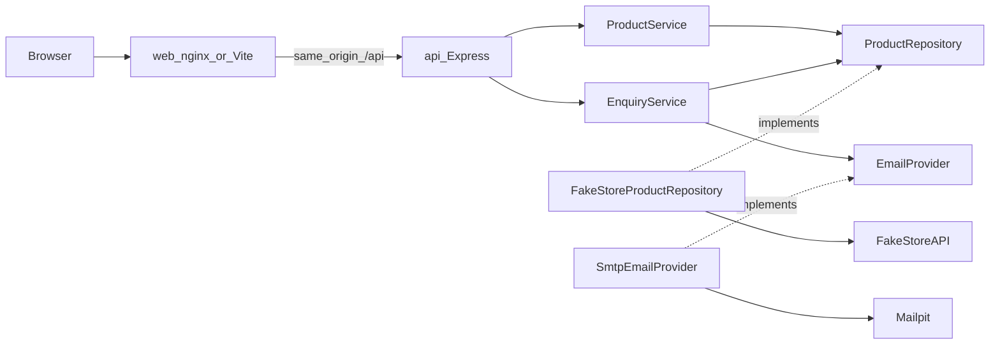

# Product Catalogue implementation plan

This document is the milestone plan for the product-catalogue PoC. Application code starts only when a milestone is requested. Finish each milestone (its files, `pnpm typecheck`, `pnpm test`, and any Docker check) before the next. Time-box is 2-3 hours; the slip rule is at the end of section 4.

Stack choice, recorded in the README in milestone 7: **React 19 + Node.js 24 / Express / TypeScript**. One language lets `@product-catalogue/shared` own the Zod contracts, and the frontend constraints (FSD, TanStack Router, shadcn) only fit React. AWS shape stays compatible without AWS accounts: stateless API container, static web assets, swappable email port.



## 1. Architecture and boundary map

Monorepo root (pnpm workspaces already declared in [pnpm-workspace.yaml](../pnpm-workspace.yaml)):

- `package.json` — private root, `packageManager` pnpm 12, `engines.node` `>=24`, scripts `dev`, `typecheck`, `test`, `build`
- `pnpm-workspace.yaml`, `pnpm-lock.yaml`, `.npmrc`, `.nvmrc` (`24`), `.env.example`, `.gitignore`
- `tsconfig.base.json` — `strict`, `noUncheckedIndexedAccess`, `noImplicitOverride`; ESM (`"type": "module"`) in every package
- `Dockerfile` is per app, build context is the repo root (see section 3)
- `docker-compose.yml`, `README.md`, `DECISIONS.md`, `AI_USAGE.md`, `docs/PLAN.md`

Business rules stay in `apps/api/src/services/`. Routes validate, call a service, and serialize. React primitives stay dumb. Fake Store JSON and `rating.rate` never leave `apps/api/src/adapters/fake-store/`.

### `packages/shared` (`@product-catalogue/shared`)

```
packages/shared/
  package.json          # exports point at dist; dependency: zod
  tsconfig.json
  src/index.ts          # re-exports
  src/product.ts        # Product, featured + detail responses
  src/category.ts       # Category, category page response
  src/search.ts         # search query + response
  src/enquiry.ts        # enquiry body + success response
  src/api-error.ts      # { error: { code, message, details? } }
  src/product.test.ts   # schema accepts domain shape, rejects unknown keys
```

API and web import schemas from `@product-catalogue/shared` only. Both depend on `zod` at the same major as shared. Shared is built to `dist` before `dev`, `typecheck`, or Docker build of the apps (`tsc`). Root `dev` builds shared once, then runs api and web in parallel.

### `apps/api` (`@product-catalogue/api`)

```
apps/api/
  package.json
  tsconfig.json
  vitest.config.ts
  Dockerfile
  src/index.ts                         # load config, wire adapters, listen 0.0.0.0
  src/app.ts                           # createApp(deps) for Supertest
  src/config.ts                        # Zod env parse, fail fast
  src/composition.ts                   # FakeStore + SMTP wiring used by index.ts
  src/ports/product-repository.ts
  src/ports/email-provider.ts
  src/services/product-service.ts      # featured, category split, search
  src/services/enquiry-service.ts
  src/services/ranking.ts              # shared comparator
  src/services/errors.ts               # AppError statuses
  src/adapters/fake-store/schema.ts    # upstream Zod, adapter-private
  src/adapters/fake-store/map-product.ts
  src/adapters/fake-store/fake-store-product-repository.ts
  src/adapters/fake-store/ttl-cache.ts
  src/adapters/smtp/smtp-email-provider.ts
  src/adapters/smtp/render-enquiry-email.ts
  src/http/error-middleware.ts
  src/http/async-handler.ts
  src/routes/health.ts
  src/routes/products.ts
  src/routes/categories.ts
  src/routes/enquiries.ts
  src/routes/api.integration.test.ts
  src/services/product-service.test.ts
  src/services/enquiry-service.test.ts
  src/adapters/fake-store/map-product.test.ts
  src/adapters/fake-store/fake-store-product-repository.test.ts
  src/adapters/smtp/render-enquiry-email.test.ts
```

`ProductRepository`: `listProducts(): Promise<Product[]>` and `getProductById(id): Promise<Product | null>`. `EmailProvider`: `send({ to, from, replyTo, subject, text, html })`.

Express 4 with `asyncHandler` (Express 5 is deferred so helmet and express-rate-limit stay on a known middleware stack). One cached `GET {FAKE_STORE_BASE_URL}/products` feeds every read; category and search are in-memory filters. That keeps `men's clothing` out of an upstream URL.

### `apps/web` (`@product-catalogue/web`)

FSD top to bottom: `app` → `pages` → `widgets` → `features` → `entities` → `shared`. Downward imports only. No sibling imports. Each slice's public API is `index.ts`. No `src/components/`.

```
apps/web/
  index.html                           # anti-flash script before CSS
  vite.config.ts                       # router plugin, then react, then tailwind
  tsconfig.json                        # paths: @/* -> src/*
  components.json                      # ui alias @/shared/ui
  nginx.conf
  Dockerfile
  vitest.config.ts
  src/main.tsx                         # QueryClient + RouterProvider
  src/test/render.tsx                  # QueryClient retry:false + test router
  src/app/styles/index.css
  src/app/routeTree.gen.ts             # generated, committed, never hand-edited
  src/app/routes/__root.tsx            # createRootRouteWithContext, SiteHeader + Outlet
  src/app/routes/index.tsx             # /
  src/app/routes/categories.$slug.tsx
  src/app/routes/products.$productId.tsx
  src/app/routes/search.tsx            # validateSearch from shared Zod
  src/pages/home/index.ts
  src/pages/home/ui/HomePage.tsx
  src/pages/category/index.ts
  src/pages/category/ui/CategoryPage.tsx
  src/pages/search/index.ts
  src/pages/search/ui/SearchPage.tsx
  src/pages/product-detail/index.ts
  src/pages/product-detail/ui/ProductDetailPage.tsx
  src/widgets/site-header/index.ts
  src/widgets/site-header/ui/SiteHeader.tsx
  src/widgets/product-section/index.ts
  src/widgets/product-section/ui/ProductSection.tsx
  src/features/toggle-theme/index.ts
  src/features/toggle-theme/model/theme-provider.tsx
  src/features/toggle-theme/ui/ModeToggle.tsx
  src/features/search-products/index.ts
  src/features/search-products/ui/SearchForm.tsx
  src/features/submit-enquiry/index.ts
  src/features/submit-enquiry/api/use-submit-enquiry.ts
  src/features/submit-enquiry/ui/EnquiryDialog.tsx
  src/entities/product/index.ts
  src/entities/product/api/queries.ts   # queryOptions: featured, detail, search, category
  src/entities/product/ui/ProductCard.tsx
  src/entities/category/index.ts
  src/entities/category/api/queries.ts  # category list only
  src/shared/api/client.ts              # VITE_API_URL or '/api'
  src/shared/lib/utils.ts               # cn()
  src/shared/ui/                        # button, input, textarea, label, card, dialog, skeleton
```

Import direction that matters: `__root` (app) renders `SiteHeader` (widget). The header imports `SearchForm` and `ModeToggle` (features) and category query (entity). Pages import `ProductSection`, `ProductCard`, and `EnquiryDialog`. `entities/product` and `entities/category` both depend on shared DTOs and do not import each other. Read `queryOptions` live under `entities/product/api`. The enquiry `useMutation` lives under `features/submit-enquiry/api`. Route files only declare the route, `validateSearch` / params, and the page component.

Vite plugin order in `apps/web/vite.config.ts`: `@tanstack/router-plugin/vite` (`routesDirectory: './src/app/routes'`, `generatedRouteTree: './src/app/routeTree.gen.ts'`) **before** `@vitejs/plugin-react`, then `@tailwindcss/vite`. Dev server proxies `/api` to `http://localhost:3001`. Router uses `@tanstack/react-router` only.

Theme: `ThemeProvider` and `ModeToggle` in `features/toggle-theme`, values `light | dark | system`, `localStorage` key `theme`, class `dark` on `documentElement`. CSS uses semantic tokens only (`bg-background`, `text-foreground`, `bg-card`, `text-muted-foreground`, `border-border`, `bg-primary`). shadcn primitives generated into `src/shared/ui` (button, input, textarea, label, card, dialog, skeleton). Add nothing else.

Pages, each with loading (`Skeleton`), empty, error, and not-found:

- `/` home: 5 featured cards
- `/categories/$slug`: headings "Top rated" and "Additional products"
- `/search?q=`: results for the validated term; header form has an input and a Search button
- `/products/$productId`: details and Enquire; success replaces the form with "Thank you. Your enquiry has been sent."

Client validation of the enquiry form calls `EnquiryBodySchema.safeParse` from shared. No react-hook-form.

## 2. Domain model and REST contract

### Product (internal)

Mapped inside the Fake Store adapter. Upstream `rating.rate` becomes `rating`. Upstream `rating.count` becomes `ratingCount`. Upstream `image` becomes `imageUrl`.

- `id` positive int
- `title` string
- `price` number (displayed as USD)
- `description` string
- `category` string (Fake Store's canonical name, including `jewelery`, `men's clothing`, `women's clothing`)
- `imageUrl` URL string (hotlinked in ``; the browser does not call the Fake Store REST API)
- `rating` number
- `ratingCount` non-negative int

`ProductSchema` is `.strict()` so a leaked `rating.rate` fails parse.

### Category page partition

Rank comparator everywhere: `rating` desc, then `ratingCount` desc, then `id` asc.

- **Featured:** `FEATURED_PRODUCT_IDS` optional, comma-separated, cap 5. Use existing ids in listed order. Unknown ids are skipped. If fewer than 5 resolve, fill from the rank comparator, skipping ids already chosen. Blank or unset uses the rank comparator only. If every id is unknown, use the rank comparator only.
- **Category:** case-insensitive match on the decoded slug against canonical category names. `topRated` = first 3 of the sorted category list. `additional` = the rest (`slice(3)`). Fewer than 3 products means a shorter `topRated` and `additional: []`. Unknown category is 404. Categories for the header are the distinct names present in the catalog, sorted by name.
- **Search:** case-insensitive substring on `title`, `description`, and `category`. Results use the same rank comparator. `q` is required, trimmed, 1–200 chars.

### Enquiry

- `productId` positive int, must exist or 404, and the email is not sent
- `name` required, trim, 1–100
- `email` required, trim, email, max 200
- `phone` optional, trim, max 30; omitted when blank
- `message` required, trim, 1–1000

HTML body escapes `& < > " '` on name, email, phone, message, and product title, then turns message newlines into `<br>`. Plain-text part uses the raw strings. Subject is `Enquiry: ${title}` with CR/LF stripped. `replyTo` is the customer email with CR/LF stripped. `to` is `SALES_INBOX_EMAIL`. `from` is `EMAIL_FROM`.

### HTTP

Error JSON, no stack in the body: `{ "error": { "code": string, "message": string, "details"?: unknown } }`.

- `GET /api/health` → `200 { "status": "ok" }`
- `GET /api/products/featured` → `200 { "products": Product[<=5] }`
- `GET /api/products/:id` → `200 { "product": Product }`; `400` non-integer id; `404` missing
- `GET /api/categories` → `200 { "categories": [{ "name", "slug" }] }` where `slug` is the canonical name (client `encodeURIComponent`s it)
- `GET /api/categories/:slug` → `200 { "category", "topRated", "additional" }`; `404` unknown. Register this as its own router so it cannot shadow other paths
- `GET /api/search?q=` → `200 { "query", "products" }`; `400` when `q` is missing, blank, or too long
- `POST /api/enquiries` → `201 { "message": "Thank you" }`; `400` Zod failure; `404` unknown product; `429` rate limit; `502` SMTP failure; `503` when the product source times out or cannot be reached; `502` when the product source returns a non-2xx or an unexpected payload

`/api/search` is a separate path so it cannot be captured by `/api/products/:id`.

Codes: `VALIDATION_ERROR` 400, `NOT_FOUND` 404, `RATE_LIMITED` 429, `UPSTREAM_ERROR` 502, `UPSTREAM_UNAVAILABLE` 503, `INTERNAL_ERROR` 500. Zod failures and invalid JSON become 400. The rate-limit handler returns the same error envelope (express-rate-limit's default body is replaced). `details` on 400 is the flattened Zod issues.

Assumptions to copy into `DECISIONS.md`:

- Featured curation is `FEATURED_PRODUCT_IDS`, with the fill rules above. There is no admin UI.
- Category slugs are the raw category strings, URL-encoded once by the client. The server matches case-insensitively after a single decode.
- One full-catalog fetch plus a 5-minute memory TTL. Category endpoints on Fake Store are not called.
- Search matches title, description, and category, ranked like the rest of the catalogue.
- Enquiry phone is optional. Success copy is "Thank you. Your enquiry has been sent."
- Prices are USD. Product images are hotlinked from `imageUrl`.
- Local web and API share `/api` (Vite proxy in dev, nginx in Docker) so the bundle does not bake a host.
- Spam control for the time-box is rate limiting. A honeypot field is deferred.
- In-memory cache is per process. More than one ECS task would need a shared cache later; the port stays the same.

## 3. Environment, Docker, networking

### `.env.example` (no secrets, never commit `.env`)

API, validated by Zod in `apps/api/src/config.ts` on startup:

- `PORT` default `3001`
- `NODE_ENV` default `development`
- `CORS_ORIGIN` default `http://localhost:5173` (Compose sets `http://localhost:8080`)
- `FAKE_STORE_BASE_URL` default `https://fakestoreapi.com`
- `PRODUCT_CACHE_TTL_MS` default `300000`
- `FEATURED_PRODUCT_IDS` optional, empty by default
- `SMTP_HOST` default `localhost` (Compose sets `mailpit`)
- `SMTP_PORT` default `1025`
- `SMTP_SECURE` default `false`
- `SMTP_USER` and `SMTP_PASS` optional; empty means no SMTP auth (Mailpit)
- `EMAIL_FROM` default `no-reply@product-catalogue.local`
- `SALES_INBOX_EMAIL` default `sales@product-catalogue.local`
- `ENQUIRY_RATE_LIMIT_WINDOW_MS` default `60000`
- `ENQUIRY_RATE_LIMIT_MAX` default `10`

Web, build-time only:

- `VITE_API_URL` optional. Unset means `/api`. Document that an absolute URL requires `CORS_ORIGIN` to match the page origin.

Security middleware on the API: `helmet()`, `cors({ origin: config.CORS_ORIGIN })`, `express.json({ limit: '16kb' })`, `express-rate-limit` on `POST /api/enquiries` only. Listen on `0.0.0.0`.

### Dockerfiles

`apps/api/Dockerfile` and `apps/web/Dockerfile`. Compose `context: .` and `dockerfile` pointed at each file. Both start from `node:24-alpine`. Install pnpm 12 by copying `/opt/pnpm` from `ghcr.io/pnpm/pnpm:12-alpine` and symlinking `pnpm` and `pnpx` into `/usr/local/bin`. Do not run `corepack enable`. If that image path differs at build time, record the path that actually works in `DECISIONS.md` and keep the symlink approach.

Stages for each Dockerfile:

1. `base` — Node 24 Alpine, pnpm 12 on `PATH`, `PNPM_HOME=/pnpm`, store dir `/pnpm/store` via `.npmrc` copied in
2. `fetch` — copy lockfile, workspace file, root package.json, and each workspace `package.json` only; `pnpm fetch`
3. `build` — copy the store from `fetch`, copy source, `pnpm install --offline --frozen-lockfile`, build shared then the app
4. API `runtime` — `node:24-alpine`, `pnpm --filter @product-catalogue/api deploy --prod` output, `CMD ["node", "dist/index.js"]`, `EXPOSE 3001`
5. Web `runtime` — `nginx:alpine` serving `apps/web/dist`, `EXPOSE 80`

`apps/web/nginx.conf`: `try_files` fallback to `index.html` for the SPA; `location /api/` proxies to `http://api:3001` and forwards the host header.

### `docker-compose.yml`

Default bridge network; service DNS names `api`, `web`, `mailpit`.

- `mailpit` — image `axllent/mailpit`, ports `8025:8025` and `1025:1025`
- `api` — build the API Dockerfile, port `3001:3001`, env from section 3 with `SMTP_HOST=mailpit` and `CORS_ORIGIN=http://localhost:8080`, `depends_on: [mailpit]`. Healthcheck uses Node `fetch` of `http://127.0.0.1:3001/api/health` (Alpine has no wget)
- `web` — build the web Dockerfile with `VITE_API_URL=/api`, port `8080:80`, `depends_on` api healthy

Reviewer URLs: app `http://localhost:8080`, API `http://localhost:3001/api/health`, inbox `http://localhost:8025`.

AWS later, same boundaries: API image on ECS Fargate or App Runner; web `dist` on S3 + CloudFront with `/api` routed to the API; `SmtpEmailProvider` replaced by an SES adapter that implements `EmailProvider`. No AWS SDK in this PoC.

## 4. Milestones

Do these in order. Each one ends with the commands listed. Diffs stay inside the milestone.

### Milestone 1 — Workspace and shared contracts

Create root `package.json`, `tsconfig.base.json`, `.nvmrc`, `.npmrc`, `.env.example`, and a real `.gitignore` (`node_modules`, `dist`, `.env`, coverage, Vite cache). Keep `PRD.pdf` ignored as it already is in [.gitignore](../.gitignore).

Create `packages/shared` as in section 1, plus schema tests for Product strictness, enquiry message max 1000, and search `q` min 1.

Update package name `@catalogue/shared` → `@product-catalogue/shared` in [AGENTS.md](../AGENTS.md), [.cursor/rules/00-architecture.mdc](../.cursor/rules/00-architecture.mdc), and [.cursor/rules/01-backend-security.mdc](../.cursor/rules/01-backend-security.mdc). Seed [DECISIONS.md](../DECISIONS.md) with the assumptions in section 2. Append the planning prompt to [AI_USAGE.md](../AI_USAGE.md) if the approval step has not already.

Verify: `pnpm install`, `pnpm typecheck`, `pnpm test`.

### Milestone 2 — Product read API with an in-memory repository

Add the API package shell: `config.ts` (Zod env), `createApp`, error middleware, health route, ports, `ranking.ts`, `ProductService`, product and category and search routes. Test double: `InMemoryProductRepository` used only from tests.

Cover featured ordering and fill rules, category mutual exclusion (including a category with 2 products and an unknown slug), and search case-insensitivity. Supertest: 200 shapes, 400 on bad id and bad `q`, 404 on missing product and category. Repository fixture uses the internal `Product` type only.

Verify: `pnpm typecheck`, `pnpm test`.

### Milestone 3 — Fake Store adapter

Add upstream schema, mapper, TTL cache, and `FakeStoreProductRepository` with injected `fetch` and clock. `AbortSignal.timeout(5000)`. Cache key is the full list. Map failures and non-2xx to `UPSTREAM_ERROR` (502). Abort and network failures to `UPSTREAM_UNAVAILABLE` (503). `index.ts` wires the real adapter.

Tests use fixture JSON (include `men's clothing`, a rating tie, and `jewelery`) and a stub `fetch`. Assert the mapped object has `rating` and `ratingCount` and has no `rate` key. Assert a second `listProducts` inside TTL does not call `fetch`, and a call after TTL does. One Supertest case: repository throws unavailable → `503` envelope.

Verify: `pnpm typecheck`, `pnpm test`.

### Milestone 4 — Enquiry, email, and security

Add `EnquiryService`, HTML/text renderer, `SmtpEmailProvider` (Nodemailer; omit auth when user is empty), `POST /api/enquiries`, helmet, CORS, JSON limit, and the custom 429 handler.

Tests: unknown product does not call `send`; HTML contains `<script>` when the message is `<script>`; plain part contains the raw message; CR/LF stripped from subject; Supertest 201 with a spy, 400, 404, and 429 using `ENQUIRY_RATE_LIMIT_MAX` of 2. No live SMTP.

Verify: `pnpm typecheck`, `pnpm test`.

### Milestone 5 — Frontend shell, theme, and routing

Scaffold Vite + React 19 + TS. Tailwind v4 (`@import "tailwindcss"`, `@import "tw-animate-css"`, `@custom-variant dark (&:where(.dark, .dark *));`, `:root` and `.dark` tokens). shadcn `components.json` aliases pointed at `src/shared/ui` before adding primitives. Anti-flash script in `index.html` using storage key `theme`.

TanStack Router file routes as in section 1, pages as thin placeholders. `SiteHeader` with `ModeToggle` and category links (query may be empty data for now). `shared/api/client.ts` and `entities/category` query. Root route context holds `QueryClient`.

RTL: ModeToggle adds and removes `dark` on `documentElement`.

Verify: `pnpm typecheck`, `pnpm test`, `pnpm --filter @product-catalogue/web build` (route tree generates and is committed).

### Milestone 6 — Catalogue pages and enquiry UI

Implement the four pages against the entity queries. `ProductCard` links to `/products/$productId`. Category page renders the two sections from `topRated` and `additional`. `SearchForm` navigates to `/search?q=<term>` and does not navigate when the term is blank. Product page opens `EnquiryDialog`; `useSubmitEnquiry` posts to `/api/enquiries`; success shows the Thank you message.

RTL with mocked `@/shared/api/client` and a fresh `QueryClient` (`retry: false`): home shows 5 cards; category sections have no duplicate titles; search submit lands on `/search?q=shirt` and renders matches; empty search result copy; enquiry success shows Thank you; product error state renders. Semantic color classes only.

Verify: `pnpm typecheck`, `pnpm test`, `pnpm build`.

### Milestone 7 — Docker, README, and submission notes

Add both Dockerfiles, `nginx.conf`, and `docker-compose.yml` as in section 3. README: stack choice, `docker compose up --build`, the three URLs, optional `pnpm dev` (copy `.env.example` to `.env`), Mailpit check, and env table. Finish `DECISIONS.md` (assumptions, deferred items below, how the ports survive a new data source / theme / SES, and a one-day next list). Finish `AI_USAGE.md` with tools, the rules files, this plan, and placeholders for later mistakes.

Deferred, to list in `DECISIONS.md`: honeypot, pagination, Playwright, CI, ESLint/Prettier, Redis, AWS SDK, admin UI for featured ids, Express 5, image proxy.

Verify: `pnpm typecheck`, `pnpm test`, `docker compose up --build`. Then `GET /api/health`, open `http://localhost:8080`, search, open a category whose name contains an apostrophe, open a product, submit an enquiry, and read the message at `http://localhost:8025`.

**Slip rule.** If the clock is past 3 hours at the end of milestone 6, still do milestone 7. Cut extra visual states before cutting Docker, README, `DECISIONS.md`, or tests of featured ranking, category exclusion, search, and enquiry.

**Another day (for DECISIONS.md):** SES adapter, shared cache for multiple tasks, Terraform or CDK for Fargate + CloudFront, honeypot, request logging, CI running `pnpm test`.

## 5. Critical-path tests

No test may call `fakestoreapi.com` or a real SMTP server. Inject the repository, the email spy, and `fetch`.

Backend unit (Vitest):

- Featured: listed ids stay in env order; unknown ids skipped; remainder filled by rank; full fallback when unset; cap 5
- Category: `topRated` and `additional` are disjoint and their union is the category; length 2 yields `additional: []`; unknown slug throws not-found; tie breaks on `ratingCount` then `id`
- Search: substring hits title, description, and category; case differs; non-matching term returns `[]`
- Enquiry: missing product skips `send`; escaped HTML; plain-text fallback; header newlines stripped
- Mapper: fixture with `rating.rate` / `rating.count` maps to `rating` / `ratingCount`; output key set has no `rate`
- Adapter: timeout signal is passed; TTL suppresses `fetch`; expired TTL refetches; encoded category name round-trips through the service match

API integration (Supertest + `createApp`):

- Featured, category, product, and search success bodies parse with shared Zod schemas
- 400, 404, 429, 502, 503 use `{ error: { code, message } }` and 503/502 do not include stack text
- 429 uses a config max of 2 so the test stays fast

Frontend (Vitest + React Testing Library + mocked client):

- Home renders five product links
- Category page shows a title in Top rated that is absent from Additional products
- Search button navigates to `/search?q=` and the page shows the mocked hit
- Enquiry submit shows the Thank you text
- ModeToggle toggles the `dark` class
- Search empty state and product not-found state render

`apps/web/src/test/render.tsx` builds the wrapper (QueryClient + router). Tests import page/feature barrels (`@/pages/home`, `@/features/toggle-theme`), not deep files.

## 6. Edge cases and risks

- **Vite plugin order.** Router plugin must be registered before `@vitejs/plugin-react`. Reversing them breaks route-tree generation or Fast Refresh. `routeTree.gen.ts` is generated output and must be committed.
- **Tailwind v4 dark variant.** Without `@custom-variant dark (&:where(.dark, .dark *));`, `dark:` follows `prefers-color-scheme` and ignores the class `ModeToggle` sets. The inline script, `ThemeProvider`, and storage key `theme` must agree or the first paint flashes.
- **FSD.** `ThemeProvider` lives in `features/toggle-theme` because the header widget cannot import from `app`. Category and product entities must not import each other. shadcn's default `src/components/ui` output has to be redirected in `components.json` before the first component is added.
- **Category slugs.** `men's clothing` and `women's clothing` need `encodeURIComponent` on the link and one decode on read. Decoding twice throws on a stray `%`. Express already decodes `%20` and `%27` once. Fake Store spells `jewelery` with one l; display that string as-is. Add a fixture and one HTTP test for the apostrophe slug.
- **Docker CORS and API URL.** The browser should call relative `/api` (Vite proxy on port 5173, nginx on port 8080). An absolute `VITE_API_URL` is baked at image build time and then needs a matching `CORS_ORIGIN`. Inside Compose, SMTP host is `mailpit`, not `localhost`. The API process must bind `0.0.0.0`. nginx must SPA-fallback to `index.html` or deep links 404 on refresh.
- **Rate limit behind nginx.** All browser traffic shares the proxy IP, so the limit is global for the demo. Leave `trust proxy` unset unless the limiter is tested with `X-Forwarded-For`. Document that in `DECISIONS.md`.
- **pnpm image layout.** Follow the `/opt/pnpm` copy from the rules. Confirm the binary exists on the first Docker build and record any path correction.
- **Helmet CSP** applies to API responses. Do not add a strict `img-src` on the web nginx config, or hotlinked product images disappear.
- **Cache stampede and tests.** Cache and clock are constructor-injected. Production uses `Date.now` and a 5-minute TTL.
